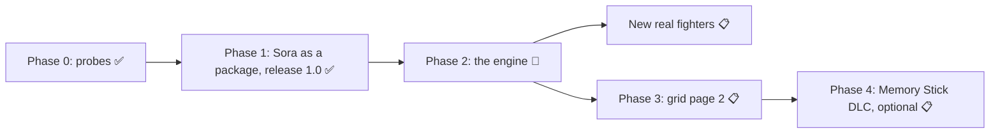

# Roadmap: every phase on one page

Status on 2026-10-22. Sources: [PHASE2-PLAN.md](PHASE2-PLAN.md) §5, the phase notes in
[notes/phase2/](../notes/phase2/), and the project's work log. If this page and a phase note disagree, the note is
newer.

**Legend:** ✅ done · 🔧 in progress · 📋 planned · ⚠ done with an open part (named)

Words: an **owner** is the game's fighter number (Sora = 33). A **package** is a folder with everything one fighter
(or the engine) adds to the clean game. The **engine** is the one-time change to the game that lets packages work.
The **oracle** is the frozen reference disc every Phase 2 disc is compared with. More: [glossary](learn/GLOSSARY.md).

---

## Phase 0: probes (✅ 2026-10-18)

Cheap, safe tests to answer "can new fighters be packages?" before building anything.
The Phase 0 plan and its result notes stay in the private working project; the findings are summed up in
[notes/dlc.md](../notes/dlc.md) (background research and lessons) and [learn/14-dlc-and-more-fighters.md](learn/14-dlc-and-more-fighters.md).

| task | in one line | status |
|---|---|---|
| P0.1 | A PSP C compiler works (pspdev, in a container). | ✅ |
| P0.2 | Our own code module loads at boot through the game's own module loader. | ✅ (PPSSPP; later also on the Vita) |
| P0.3 | How much free memory the module gets (largest free block 247,040 bytes after boot). | ✅ |
| P0.4 | Owner 34 is usable like 33 (only Cosmos's model id 1338 collides). | ✅ static |
| P0.5 | The character grid has 34 cells per page, so exactly one more fighter fits. | ✅ |
| P0.6 | The game can read a plain (not encrypted) DLC file from the Memory Stick. | ⚠ stage A on PPSSPP; stage B and real PSP open |
| P0.7 | Our own file list (`EXTRA.IDX`) answers file lookups first: the disc's full file list is no longer a wall. | ✅ |
| P0.8 | Every per-fighter table in the game written down as data (`tools/dlc/owner_tables.json`, 89 entries). | ✅ |
| P0.9 | The game's Data Install is a cache, not a delivery route; installer options studied. | ✅ static |

## Phase 1: Sora as a package, one installer, release 1.0 (✅ released 2026-10-20)

Sora's ~65 build scripts became one package plus one installer, and the release became a patch app.
The Phase 1 plan and its result notes stay in the private working project. How 1.0 shipped: [notes/release-1.0-lessons.md](../notes/release-1.0-lessons.md). Policy: [RELEASE-POLICY.md](RELEASE-POLICY.md).

| task | in one line | status |
|---|---|---|
| P1.0 | Freeze a reference build of Sora (built twice, same bytes). | ✅ |
| P1.1 | The package format: [PACKAGE-FORMAT.md](PACKAGE-FORMAT.md) v1.0 + checker `tools/pkg/validate.py`. | ✅ |
| P1.2 | Extractor: reference build minus clean disc = Sora's package (`tools/pkg/extract.py`). | ✅ |
| P1.3 | Installer, layout A (Sora's files in the game's own file list). | ✅ |
| P1.4 | Production `EXTRA.PRX`: file lookup through `EXTRA.IDX` ([ENGINE.md](ENGINE.md)). | ✅ |
| P1.5 | Layout B: the game's file list stays clean; the release layout. | ✅ |
| P1.6 | Equivalence checker: do two discs give the game the same bytes? (`tools/pkg/equiv.py`) | ✅ |
| P1.7 | Runtime check of layout B. | ⚠ PPSSPP strict smoke and Vita checks passed for the release; real PSP open |
| P1.8 | Release identity: no change to the game's title, disc code or save id. | ✅ decided |
| P1.9 | Release delta: one VCDIFF patch + `release.json` (`tools/pkg/make_release.py`). | ✅ |
| P1.10 | Player patch app for Windows, macOS, Linux ([INSTALLER-TECH.md](INSTALLER-TECH.md), [INSTALLER-UX.md](INSTALLER-UX.md)); source: <https://github.com/MatNyaga/sora-fan-patch>. | ✅ shipped with 1.0 |
| P1.11 | Docs. | ✅ via the public docs rewrite (2026-10-20) and this docs layer |

After 1.0: a **1.0.1 candidate** (Sora's name on Quick Battle "Opponent Info") is built, not released.

### What was checked for 1.0

On release-candidate builds in PPSSPP, using copies of a fresh save and a 100 % save:

- Buying Sora in the PP Catalog, his NEW tag, and the KH2 icons, avatar and music purchases (they no longer clash
  with flags the game uses for level rewards).
- Saves: Sora's record takes friend card slot 25. On a save that already holds 25 cards, the oldest unlocked card
  makes room, the same way the game handles a new card. Sora's level and progress survive saving and reloading.
- Moves on old saves: a one-time catch-up gives Sora every move his level already earned.
- Battles in Quick Battle, Arcade and Labyrinth, mirror matches, and CPU Sora at maximum strength.
- EX Mode ending and clean-up between rounds; replays.
- Menus: Equipment and Optimize, the Characters panel, Records, the Museum viewer with all six outfits,
  and the Jukebox (Sora's voice set and music only show once bought; vs Sora uses the stage music if the KH2 tracks
  aren't bought).
- Original Quest: create, test, save, load, play, forfeit, retry and return; Sora's slot face, name and banner are
  correct.
- Friend cards and ghosts with Sora; Sora as an assist; Data Install on the release layout.
- The patch app on Linux: real-window runs produce the exact expected file and handle every error case.

On a **PS Vita with Adrenaline**: boot, character select, Sora battles, EX Mode, winning and returning to the menu,
Data Install and Sora as an assist all pass. An early crash in every Sora battle on the Vita (a missing Sora row in a
game table that the emulator ignored) was found and fixed this way.

### How 1.0 shipped (20 October 2026)

1. **Release candidate 3** became release 1.0: a clean build with the latest fixes (the Vita crash fix, Original
   Quest menu fixes and faster menus on the Vita).
2. **Patch app** for Windows, macOS and Linux, on the
   [releases page](https://github.com/MatNyaga/sora-fan-patch/releases).
3. **Project page:** <https://matnyaga.github.io/sora-fan-patch/>.
4. This research repository was refreshed with the newer tools (and, on 22 October, with the docs for modders and the
   research notes).

### Known issues in 1.0

- In Quick Battle, "Opponent Info" shows no name for Sora (cosmetic; fixed in the 1.0.1 candidate, not released yet).
- On a Vita, menus can feel a little slower than in the original game. Release 1.0 keeps menus at the higher
  CPU speed (`tools/scripts/spot33_menuclock.py`), which is much better in testing.
- Some old Adrenaline game plugins stop the game from starting; turn game plugins off.
- A real PSP has not been tested. It will need custom firmware.
- Not covered yet: Chaos's round-specific lines, Aerith-assist lines and Cosmos story scenes keep the game's
  normal behaviour.
- Playing online or ad hoc with someone who doesn't have the same mod is not supported.

## Phase 2: the generic fighter engine (🔧 since 2026-10-19)

Turn the 86 "owner 33 = Sora" places into one generic engine, then prove it twice: Sora rebuilt on the engine must
behave exactly like the release, and a throw-away test fighter on owner 34 must work with no new fighter code.
Plan: [PHASE2-PLAN.md](PHASE2-PLAN.md). Guide for helpers: [PHASE2-START.md](PHASE2-START.md).
How it works, as a learning chapter: [learn/15-engine-and-registry.md](learn/15-engine-and-registry.md).
Notes: [notes/phase2/](../notes/phase2/). Picture: [modding/OVERVIEW.md](modding/OVERVIEW.md).

| task | in one line | status |
|---|---|---|
| P2.0 | Freeze the oracle disc and list every owner-33 place from the bytes (86 places). | ✅ 2026-10-20 |
| P2.1 | Engine interface: registry row layout, stub table, feature ids ([ENGINE.md](ENGINE.md)). | ⚠ done; a Codex review is still requested |
| P2.2 | Registry builder and checker (`tools/dlc/registry.py`). | ✅ 2026-10-19 |
| P2.3 | Lookups (names, pictures, Museum, Original Quest face, unlock gates) through per-fighter tables the installer writes. | ✅ 2026-10-21 |
| P2.4 | Sora's behaviour in C inside `EXTRA.PRX`: EX run speed, Trinity Limit, Reflect guard, item effects, item menus. | ✅ 2026-10-21 (also checked on the Vita) |
| P2.5 | Save records for any package fighter: record slot = 57 − owner, one migration for all. | ✅ 2026-10-22 |
| P2.6 | Free id and flag pools, with a list of the flags the game itself writes. | ⚠ done; the allocator script is not written |
| P2.7 | Shared capacity: grid rows moved to room for a 34th cell, one generic writer for every installer number, title call generated. | ✅ 2026-10-22 |
| P2.8 | Sora as package #1 on the engine: engine package, format 1.1, installer layout C. | 🔧 first discs built 2026-10-22, testing ([P2.8-build.md](../notes/phase2/P2.8-build.md)) |
| P2.9 | Test fighter on owner 34 (a Cloud copy, never released). | 📋 recipe ready ([P2.9-testfighter.md](../notes/phase2/P2.9-testfighter.md)); needs P2.8 |
| P2.10 | Acceptance list + test kit ([PACKAGE-ACCEPTANCE.md](PACKAGE-ACCEPTANCE.md), `tools/qa/acceptance/`). | ⚠ static kit done; runtime dry run open |
| P2.11 | Delivery: one installer with a fighter-pack checklist, all from the player's clean disc. | ✅ decided (2026-10-19); app change not built |
| P2.12 | Real-hardware gate on Mat's PS Vita ([TEST-ON-VITA.md](TEST-ON-VITA.md)). | ⚠ release and the P2.4 disc pass; the P2.8 disc is next |
| P2.13 | Docs for modders: [README](../README.md), this page, [modding/](modding/OVERVIEW.md), [learn chapter 15](learn/15-engine-and-registry.md), glossary. | 🔧 2026-10-22 |

## New real fighters (📋 after P2.9)

No fighter is chosen yet. ([notes/dlc.md](../notes/dlc.md) §4.2 costs Riku as an example.) With the engine, a new
fighter is mostly art and sound work: model, animations, effects, voices. Before a real second fighter the engine
still needs, from [P2.7-capacity.md](../notes/phase2/P2.7-capacity.md) §3 and §8:

- a line in the Records list (about 40-60 code words plus data),
- its own EX Mode page in Customization (a new home for a 1.1 KB table),
- a start-equipment preset (data only: an unused Chaos preset can be rewritten),
- a Jukebox entry (a registry flag) and a title-call day (days 26 and 31 are free).

How to make one, as far as it works today: [modding/MAKE-A-FIGHTER.md](modding/MAKE-A-FIGHTER.md).

## Phase 3: a second grid page, more than 34 cells (📋)

Today each character grid page has 34 cells: Sora plus one more fighter. More fighters need an L/R page on the
select screens, and the Characters panel (31 layout cells) needs a new layout. Owners 35 and up also need save and
table work. Least known part; rough estimate 2-5 days of helper work ([notes/dlc.md](../notes/dlc.md) §4.1).
No plan document yet.

## Phase 4: Memory Stick drop-in DLC (📋 optional)

Load packages at boot from the Memory Stick and merge their tables in memory, instead of installing them into the
ISO. Possible (P0.6 proved the game reads plain DLC files), but it adds runtime risk for little gain over "install a
package with a tool" ([notes/dlc.md](../notes/dlc.md) §3.2, §4.1). Only after the engine is finished.

## Optional ideas

Not needed for a release, and only if they're picked later: a Sora story campaign or ending, a Keyblade crafting
chain, more music or voice content, and new manikin content.

## How you can help

- Test on a **real PSP** with custom firmware and report what happens.
- Report bugs with your version, platform and steps ([CONTRIBUTING.md](../CONTRIBUTING.md); findings: [modding/CONTRIBUTING.md](modding/CONTRIBUTING.md#how-to-report-a-finding)).
