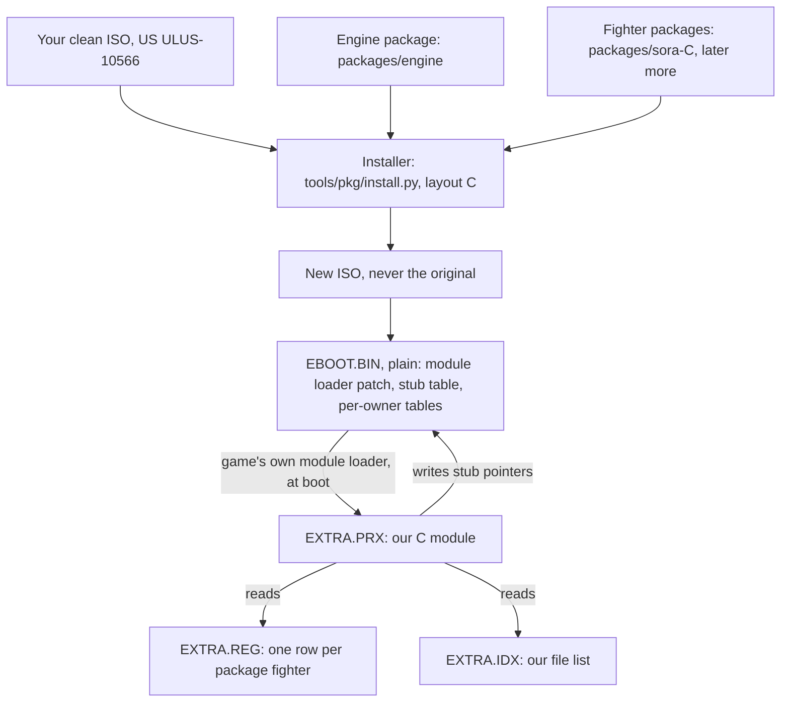

# How it fits together (one page)

This page explains the architecture of the Sora patch and its fighter engine. It is the map; the detail is in
[ENGINE.md](../ENGINE.md) (the engine) and [PACKAGE-FORMAT.md](../PACKAGE-FORMAT.md) (the package folder).
Terms are in the [glossary](../learn/GLOSSARY.md#phase-2-engine-and-package-terms).

Status words: **works today** = built and tested in the emulator (and where named, on a PS Vita); **in progress** =
being built now (Phase 2 task P2.8); **planned** = designed, not built. Phases: [ROADMAP.md](../ROADMAP.md).

---

## The idea in four sentences

The game knows its fighters by an **owner** number (the game's fighter number: vanilla playable fighters are 1-32,
Sora is 33). Release 1.0 adds Sora by changing about 86 places that, in effect, say "owner 33 = Sora". The
**engine** replaces those places once with generic ones that read small per-fighter tables. A new fighter is then a
**package** (a folder of data) that an **installer** merges into your own clean copy of the game.

## The picture

Players do not run the installer themselves. The patch app applies one patch (a VCDIFF delta) that turns the
player's clean ISO into the installed result. Release 1.0 ships Sora this way in **layout B** (see below).
A patch app with a fighter-pack checklist is **planned** (Phase 2 decision P2.11).

## The pieces, from the disc up

### 1. The disc and the plain EBOOT
- `PSP_GAME/SYSDIR/EBOOT.BIN` is the game's main program. On the original disc it is encrypted. The installer
  decrypts **your own** copy (step `produce: eboot_plain`), so no game code is ever shipped. A decrypted EBOOT needs
  custom firmware on real hardware; PPSSPP and Adrenaline on the Vita run it.
- The battle code and the menu code are two **overlays** (`USRDIR/DATA/OVL_BATTLE_APP.ELF`, `OVL_MENU_APP.ELF`).
  They take turns at the same memory address, `0x089DD4C0`. Code that touches an overlay must check which one is
  loaded first.
- Details: [learn/01-the-disc.md](../learn/01-the-disc.md), [learn/07-game-code.md](../learn/07-game-code.md).

### 2. The module loader patch (works today)
A small EBOOT change (53 words) makes the game's own module loader also start `DATA/MODULE/EXTRA.PRX` at boot, the
way it starts the game's own modules. If the file is missing, nothing happens and the game runs as vanilla.

### 3. EXTRA.PRX, our C module (works today)
- Written in C (`tools/pkg/engine/extra/`: `extra.c`, `v2.c`, `beh.c`), built with the pspdev compiler. Current
  version: engine **2.5.0**.
- At boot it (a) loads `EXTRA.IDX` and patches **one instruction in memory** in the game's "find file" function, so
  our file list is asked first; (b) loads `EXTRA.REG`, publishes the rows, and only then (c) writes the **stub
  pointers** (data words, never instructions). Every check that fails leaves the game vanilla.
- It runs Sora's special behaviour: EX run speed, the Trinity Limit, the Reflect guard, item effects and item menus.
- It keeps a status block in memory (signature `XTRA`); `tools/pkg/engine/find_status.py PORT` prints it through
  PPSSPP's debugger.
- **The 16-byte stack rule:** module C must call game code only through an aligning thunk. The C compiler keeps the
  stack 8-byte aligned, the game's vector stores need 16. Breaking it froze the emulator once
  ([P2.4-tri.md](../../notes/phase2/P2.4-tri.md) §8). `tools/qa/acceptance/stack_rule.py` checks it.

### 4. The stub table, XSTB (works today)
- A fixed table in a never-called part of the EBOOT. Its header (`XSTB`) sits at **EBOOT `0x089A8B24`** and points at
  the stub arrays.
- A **stub** is 4 instructions: `lui at / lw at,FN_PTR / jr at / nop`. It jumps wherever its pointer says: into the
  module if the module loaded and a package uses that feature, otherwise into a **fallback** (a copy of the
  original game instructions).
- A **hook** is one changed game instruction that calls a stub instead of the old code.
- The stub list has a hash (`abi_hash`, today `0x2F2EAE84`) so the module refuses a disc built for another list.

### 5. EXTRA.REG, the registry (works today)
- `PSP_GAME/USRDIR/DATA/EXTRA.REG`: one 64-byte **registry row** per package fighter (owner, name index, record
  slot, pictures, feature bits, parameters), plus item, flag and string sections.
- Built by `tools/dlc/registry.py build` from each package's `registry.json` (the **registry source**).
- Code that needs a fighter's row asks the EBOOT helper **REG_ROW** ("give me owner N's row, or 0").

### 6. Per-owner tables written by the installer (works today)
Most "is this owner 33?" places did not need module code at all. They became small tables, indexed by owner, that
the installer fills in: vanilla values for owners 0-32, package values for 33 and 34. They cost what vanilla costs,
the installer can check them offline, and they work even without the module.

| block | where (EBOOT) | holds |
|---|---|---|
| **OXT** (owner-extension tables) | `0x089A8B94-0x089A8F0C` | picture index, party frame, setup banner, Museum viewer owner, Records icon, panel sprite, Original Quest face pair, name-key pool (`KEY_POOL` at `0x089A8D7C`) |
| **GRD1** | `0x089C2140-0x089C2340` | the Quick Battle / select-grid rows (34 cells) + the 34-entry cap |
| **SRC1** | `0x089C2340-0x089C2508` | save-record data: friend-card cap, catch-up markers |

Plus about 20 tables and limits that already existed in the game (unlock rows, Opponent Info names, title-call
tables, list sizes); the installer computes their values (`tools/pkg/rowgen.py`, one generic writer).

### 7. Packages (Sora on the engine: in progress)
- A **package** is a folder: `manifest.json` (who it is, every number it takes, every file with its sha256),
  `registry.json`, `files/` (whole files it adds or replaces), `rows/` (small edits inside shared game files).
- **Format 1.1** stores each edit by **what it is** (owner, text entry, model id, picture id), never by its final row
  position. That is what lets two packages edit the same shared table.
- The **engine package** (`packages/engine`, kind `engine`) holds `EXTRA.PRX`, the module loader patch, the menu
  clock fix and the engine's code words (about 890 words, "old" = the clean game's words).
- Sora's package in format 1.1 is `packages/sora-C`. It carries **no game-code patches**.
- Packages hold data derived from the game: **never publish a package folder.**

### 8. The installer (layout C: in progress)
`python3 -I tools/pkg/install.py CLEAN.iso OUT.iso packages/engine packages/sora-C --layout C`
- Refuses anything but the known clean dump; never overwrites; writes `OUT.iso.part` and renames it only after a
  self-check.
- Order: decrypt the EBOOT → engine code words → per-owner tables for the whole roster → rows in shared files →
  whole files → `EXTRA.REG`, `EXTRA.PRX`, `EXTRA.IDX` → self-check.
- It is designed to stay generic: it should never compare an owner with a number; owner limits come from data
  (`tools/dlc/owner_tables.json` and the registry checker).

## Disc layouts

| layout | Sora's files are found through | owner-33 code patches | module | used for |
|---|---|---|---|---|
| **R** | the game's own file list (`PACKAGE_INFO.BIN`) | yes | no | reference builds by `build_sora.sh` |
| **A** | the game's own file list | yes | no | the first installer output |
| **B** | `EXTRA.IDX`; the game's file list stays clean | yes | file lookup only | **release 1.0** |
| **C** | `EXTRA.IDX` | **no** (engine + registry instead) | full engine | Phase 2, in progress |

## What lives where

The layout of the working project. In this repository the engine v2 sources, the Phase 2 builders, the
acceptance kit and the registry sources are not published yet
([list](../REPRODUCIBILITY.md#phase-2-tools-not-in-this-snapshot)); `packages/` is never published.

| path | what |
|---|---|
| `tools/pkg/engine/extra/` | module source; frozen module copies per step in subfolders (`flags/` = engine 2.5.0) |
| `tools/pkg/engine/` | stub writer `p24_stubs.py`, `install_engine.py`, test-disc recipes `build_p2*.sh`, `patches/` (P2.3-P2.7 writers), host tests in `test/` |
| `tools/pkg/` | `install.py`, `extract.py`, `pkg11.py`, `validate.py`, `pkgformat.py`, `pkgapply.py`, `equiv.py`, `rowgen.py`, `make_release.py` |
| `tools/dlc/` | `registry.py`, registry sources `registry/sora.json` + `registry/test34.json`, the table spec `owner_tables.json`, free flags `flag_map.json`, free ids `id_spaces.json` |
| `tools/qa/` | static checks and the acceptance kit (`acceptance/`), runtime helpers (`runtime/`) |
| `tools/installer/` | an early copy of the patch app (the maintained one is <https://github.com/MatNyaga/sora-fan-patch>) |
| `packages/` | `engine`, `sora-C` (format 1.1), `sora-R4` (frozen format-1.0 Sora, the reference) and older copies |

## Limits today

- **Owners 33 and 34 only.** Owner 35 and up need save and table work (Phase 3); the checker refuses them.
- **34 cells per grid page**, so Sora plus one more fighter. A second page is Phase 3.
- Fighter #2's other known limits are listed in [MAKE-A-FIGHTER.md](MAKE-A-FIGHTER.md#known-limits-for-a-second-fighter).

## Read next

- Making a fighter: [MAKE-A-FIGHTER.md](MAKE-A-FIGHTER.md). Checking a change: [TESTING.md](TESTING.md).
- The engine in depth: [ENGINE.md](../ENGINE.md). The package format: [PACKAGE-FORMAT.md](../PACKAGE-FORMAT.md).
- The teaching version, with a worked example: [learn/15-engine-and-registry.md](../learn/15-engine-and-registry.md).
- Why it was built this way: [learn/14-dlc-and-more-fighters.md](../learn/14-dlc-and-more-fighters.md),
  [notes/dlc.md](../../notes/dlc.md) §F (lessons).
